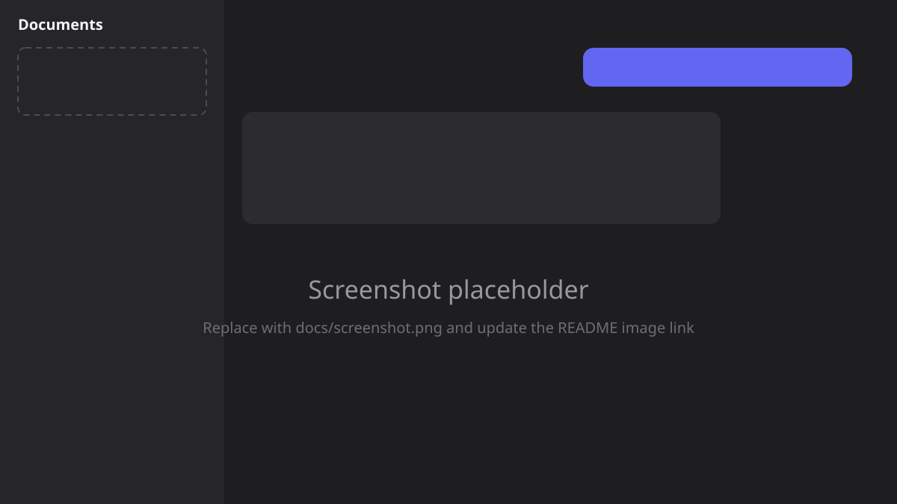
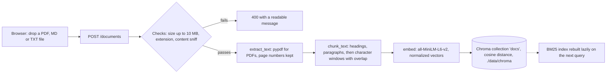
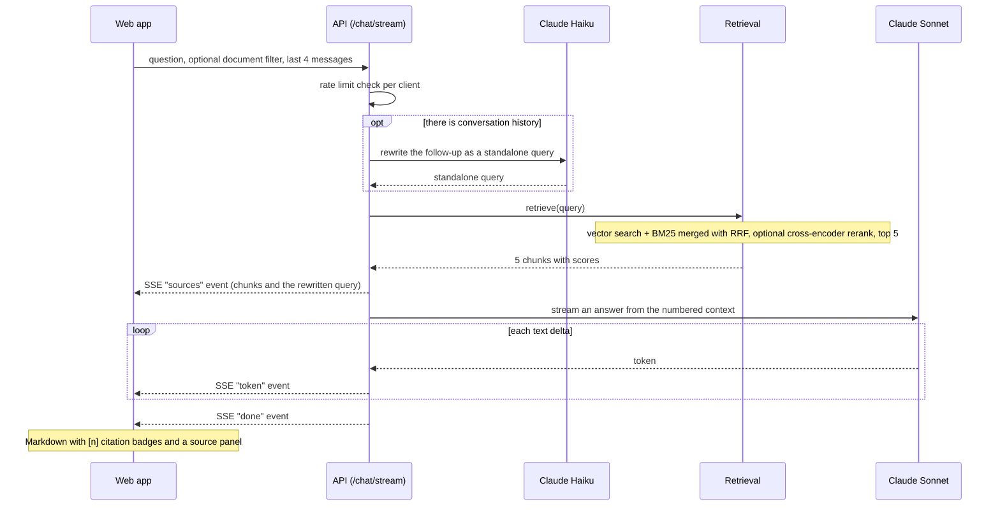

# DocChat

Upload documents, then chat with them. Answers stream in token by token and cite their sources: click a `[1]` badge to see the exact passage, page and similarity score behind it.

<!-- Replace the placeholder with a real screenshot: save it as docs/screenshot.png and change the path below. -->


## Features

- **Ingest** PDF, Markdown and text files (up to 10 MB). PDFs keep page numbers; Markdown headings are attached to every chunk.
- **Hybrid retrieval**: vector search plus BM25, merged with Reciprocal Rank Fusion, with an optional cross-encoder reranker.
- **Follow-up questions** are rewritten into standalone search queries using the last four messages.
- **Streaming answers** over Server-Sent Events, with a Stop button.
- **Citations**: `[n]` markers become clickable badges that open the source passage. A marker with no matching source is left as plain text.
- **Safe by default**: rate limiting on the chat endpoints, upload size and content checks, no images rendered from document-derived text.

## Architecture

### Ingest flow



### Query flow



If the client disconnects (or presses Stop) the API closes the upstream stream, which stops generation.

## Quick start

You need an [Anthropic API key](https://console.anthropic.com/).

### Docker

```bash
cp .env.example .env        # then set ANTHROPIC_API_KEY in .env
docker compose up --build
```

Open <http://localhost:5173>. The API is on <http://localhost:8000> (interactive docs at `/docs`).
The first start downloads the embedding model (about 90 MB), so the API takes a minute to become healthy.
`./data` is mounted into the container and holds the vector store and the model cache, so your documents survive restarts.

### Local development

On a fresh macOS or Linux machine, one script installs everything that is missing (uv, Node, pnpm, dependencies, `.env`, the embedding model):

```bash
bash scripts/setup.sh
```

Or, if you already have [uv](https://docs.astral.sh/uv/), Node 20+ and pnpm:

```bash
pnpm install
cd apps/api && uv sync && cd ../..
cp .env.example .env         # then set ANTHROPIC_API_KEY
pnpm dev                     # API on :8000 and web on :5173
```

Other scripts: `pnpm dev:api`, `pnpm dev:web`, and `pnpm gen:types` (regenerates `packages/api-client` from the running API's OpenAPI schema).

## Configuration

Settings are read from the environment, or from a `.env` file at the repository root.

| Variable | Default | Purpose |
| --- | --- | --- |
| `ANTHROPIC_API_KEY` | (none) | Required for answers. Without it `/chat` returns 503 with a clear message. |
| `RETRIEVAL_MODE` | `hybrid` | `vector` or `hybrid` (vector + BM25 merged with RRF). |
| `RERANK` | `false` | `true` re-scores the top candidates with a cross-encoder (downloads about 90 MB on first use). |
| `RETRIEVAL_CANDIDATES` | `20` | How many candidates are fetched before fusion and reranking. The final answer uses the top 5. |
| `RATE_LIMIT_PER_MINUTE` | `20` | Requests per client per minute on `/chat` and `/chat/stream`; `0` disables the limit. |
| `CORS_ORIGINS` | `http://localhost:5173` | Comma-separated origins allowed to call the API. |
| `CHROMA_PATH` | `<repo>/data/chroma` | Where the vector store is persisted. |
| `HF_HOME` | Hugging Face default | Where downloaded models are cached (the Docker image uses `/data/hf`). |
| `VITE_API_URL` | `http://localhost:8000` | API address baked into the web app at build time. Read from the root `.env` by `docker compose`; for `pnpm dev:web` set it in your shell or `apps/web/.env`. |

## API

| Endpoint | Description |
| --- | --- |
| `POST /documents` | Multipart upload (`file`): PDF, MD or TXT, up to 10 MB. Returns `{id, filename, chunk_count}`. |
| `GET /documents` | Lists documents with chunk counts and upload times. |
| `DELETE /documents/{id}` | Removes a document and all of its chunks. |
| `POST /chat/stream` | Body `{question, document_ids?, history?}`. Streams `sources`, `token`, `done` and `error` events. |
| `POST /chat` | The same, non-streaming: returns `{answer, sources, rewritten_question}`. |
| `GET /health` | Liveness check. |

```bash
curl -F "file=@apps/api/tests/fixtures/sample.md" http://localhost:8000/documents
curl -N -X POST http://localhost:8000/chat/stream \
  -H 'Content-Type: application/json' \
  -d '{"question": "Which planets are gas giants?"}'
```

## Tests, checks and the retrieval eval

```bash
cd apps/api && uv run pytest                 # backend tests (no models, no network, no API key needed)
pnpm --filter web test                       # frontend unit tests (Vitest + React Testing Library)
pnpm --filter web typecheck                  # TypeScript
pnpm --filter web lint                       # oxlint
```

GitHub Actions (`.github/workflows/ci.yml`) runs the backend tests, the frontend type-check, lint and unit tests on every push and pull request.

The retrieval eval ingests the sample documents in `apps/api/eval/docs` into a throwaway store, asks the questions in `apps/api/eval/questions.json` in each retrieval mode, and prints hit@k and MRR:

```bash
cd apps/api
uv run python -m eval.run                    # all four modes
uv run python -m eval.run --modes vector hybrid --verbose
```

Latest run (123 chunks, 20 questions, k=5):

| mode | hit@1 | hit@5 | MRR@5 | ms/query |
| --- | --- | --- | --- | --- |
| vector | 0.75 | 1.00 | 0.875 | 5 |
| hybrid | 0.85 | 1.00 | 0.925 | 4 |
| vector+rerank | 0.85 | 1.00 | 0.925 | 35 |
| hybrid+rerank | 0.85 | 1.00 | 0.925 | 35 |

This is a small eval: the gaps are two questions out of twenty. Hybrid is the default because it matches the reranked modes at a fraction of the latency. Re-run it with your own documents before trusting these numbers.

## Project layout

```
apps/api/            FastAPI backend (Python 3.12, uv)
  app/               main.py (routes), ingest.py, retrieve.py, generate.py, store.py
  eval/              retrieval eval harness, sample docs and questions
  tests/             pytest suite
apps/web/            React 18 + TypeScript + Vite
packages/api-client/ TypeScript types generated from the API's OpenAPI schema
scripts/setup.sh     one-shot setup for a fresh machine
docker-compose.yml   runs the API and the web app
```

## Known limitations

- There is no authentication: every visitor sees and can delete every document.
- Rate limiting is in-process and keyed by client address, so it is per server process and does not look at `X-Forwarded-For`.
- Scanned PDFs (images without a text layer) are rejected; there is no OCR.
- The Linux Docker image is large because PyPI's `torch` wheel bundles CUDA libraries.
